<picture>
  <source media="(max-width: 640px) and (prefers-color-scheme: dark)" srcset="assets/banner-narrow-dark.svg">
  <source media="(max-width: 640px) and (prefers-color-scheme: light)" srcset="assets/banner-narrow-light.svg">
  <source media="(prefers-color-scheme: dark)" srcset="assets/banner-dark.svg">
  <source media="(prefers-color-scheme: light)" srcset="assets/banner-light.svg">
  
</picture>

<a href="https://www.darky.dev"><picture><source media="(prefers-color-scheme: dark)" srcset="assets/chip-site-dark.svg"><source media="(prefers-color-scheme: light)" srcset="assets/chip-site-light.svg"></picture></a><a href="mailto:me@darky.dev"><picture><source media="(prefers-color-scheme: dark)" srcset="assets/chip-mail-dark.svg"><source media="(prefers-color-scheme: light)" srcset="assets/chip-mail-light.svg"></picture></a>

<picture>
  <source media="(max-width: 640px) and (prefers-color-scheme: dark)" srcset="assets/chapter-projects-narrow-dark.svg">
  <source media="(max-width: 640px) and (prefers-color-scheme: light)" srcset="assets/chapter-projects-narrow-light.svg">
  <source media="(prefers-color-scheme: dark)" srcset="assets/chapter-projects-dark.svg">
  <source media="(prefers-color-scheme: light)" srcset="assets/chapter-projects-light.svg">
  
</picture>

<picture>
  <source media="(max-width: 640px) and (prefers-color-scheme: dark)" srcset="assets/upcoming-narrow-dark.svg">
  <source media="(max-width: 640px) and (prefers-color-scheme: light)" srcset="assets/upcoming-narrow-light.svg">
  <source media="(prefers-color-scheme: dark)" srcset="assets/upcoming-dark.svg">
  <source media="(prefers-color-scheme: light)" srcset="assets/upcoming-light.svg">
  
</picture>

<a href="https://github.com/darkyeg/spinup"><picture><source media="(max-width: 640px) and (prefers-color-scheme: dark)" srcset="assets/project-spinup-narrow-dark.svg"><source media="(max-width: 640px) and (prefers-color-scheme: light)" srcset="assets/project-spinup-narrow-light.svg"><source media="(prefers-color-scheme: dark)" srcset="assets/project-spinup-dark.svg"><source media="(prefers-color-scheme: light)" srcset="assets/project-spinup-light.svg"></picture></a><a href="https://github.com/darkyeg/echobridge"><picture><source media="(max-width: 640px) and (prefers-color-scheme: dark)" srcset="assets/project-echobridge-narrow-dark.svg"><source media="(max-width: 640px) and (prefers-color-scheme: light)" srcset="assets/project-echobridge-narrow-light.svg"><source media="(prefers-color-scheme: dark)" srcset="assets/project-echobridge-dark.svg"><source media="(prefers-color-scheme: light)" srcset="assets/project-echobridge-light.svg"></picture></a><a href="https://github.com/kozan-rs/kozan"><picture><source media="(max-width: 640px) and (prefers-color-scheme: dark)" srcset="assets/project-kozan-narrow-dark.svg"><source media="(max-width: 640px) and (prefers-color-scheme: light)" srcset="assets/project-kozan-narrow-light.svg"><source media="(prefers-color-scheme: dark)" srcset="assets/project-kozan-dark.svg"><source media="(prefers-color-scheme: light)" srcset="assets/project-kozan-light.svg"></picture></a><a href="https://github.com/darkyeg/dotfiles"><picture><source media="(max-width: 640px) and (prefers-color-scheme: dark)" srcset="assets/project-dotfiles-narrow-dark.svg"><source media="(max-width: 640px) and (prefers-color-scheme: light)" srcset="assets/project-dotfiles-narrow-light.svg"><source media="(prefers-color-scheme: dark)" srcset="assets/project-dotfiles-dark.svg"><source media="(prefers-color-scheme: light)" srcset="assets/project-dotfiles-light.svg"></picture></a>

<picture>
  <source media="(max-width: 640px) and (prefers-color-scheme: dark)" srcset="assets/opensource-narrow-dark.svg">
  <source media="(max-width: 640px) and (prefers-color-scheme: light)" srcset="assets/opensource-narrow-light.svg">
  <source media="(prefers-color-scheme: dark)" srcset="assets/opensource-dark.svg">
  <source media="(prefers-color-scheme: light)" srcset="assets/opensource-light.svg">
  
</picture>

<picture>
  <source media="(max-width: 640px) and (prefers-color-scheme: dark)" srcset="assets/chapter-numbers-narrow-dark.svg">
  <source media="(max-width: 640px) and (prefers-color-scheme: light)" srcset="assets/chapter-numbers-narrow-light.svg">
  <source media="(prefers-color-scheme: dark)" srcset="assets/chapter-numbers-dark.svg">
  <source media="(prefers-color-scheme: light)" srcset="assets/chapter-numbers-light.svg">
  
</picture>

<picture>
  <source media="(max-width: 640px) and (prefers-color-scheme: dark)" srcset="assets/numbers-narrow-dark.svg">
  <source media="(max-width: 640px) and (prefers-color-scheme: light)" srcset="assets/numbers-narrow-light.svg">
  <source media="(prefers-color-scheme: dark)" srcset="assets/numbers-dark.svg">
  <source media="(prefers-color-scheme: light)" srcset="assets/numbers-light.svg">
  
</picture>

<picture>
  <source media="(max-width: 640px) and (prefers-color-scheme: dark)" srcset="assets/activity-narrow-dark.svg">
  <source media="(max-width: 640px) and (prefers-color-scheme: light)" srcset="assets/activity-narrow-light.svg">
  <source media="(prefers-color-scheme: dark)" srcset="assets/activity-dark.svg">
  <source media="(prefers-color-scheme: light)" srcset="assets/activity-light.svg">
  
</picture>

<picture>
  <source media="(max-width: 640px) and (prefers-color-scheme: dark)" srcset="assets/stand-narrow-dark.svg">
  <source media="(max-width: 640px) and (prefers-color-scheme: light)" srcset="assets/stand-narrow-light.svg">
  <source media="(prefers-color-scheme: dark)" srcset="assets/stand-dark.svg">
  <source media="(prefers-color-scheme: light)" srcset="assets/stand-light.svg">
  
</picture>

<picture>
  <source media="(max-width: 640px) and (prefers-color-scheme: dark)" srcset="assets/chapter-time-narrow-dark.svg">
  <source media="(max-width: 640px) and (prefers-color-scheme: light)" srcset="assets/chapter-time-narrow-light.svg">
  <source media="(prefers-color-scheme: dark)" srcset="assets/chapter-time-dark.svg">
  <source media="(prefers-color-scheme: light)" srcset="assets/chapter-time-light.svg">
  
</picture>

<picture>
  <source media="(max-width: 640px) and (prefers-color-scheme: dark)" srcset="assets/waka-narrow-dark.svg">
  <source media="(max-width: 640px) and (prefers-color-scheme: light)" srcset="assets/waka-narrow-light.svg">
  <source media="(prefers-color-scheme: dark)" srcset="assets/waka-dark.svg">
  <source media="(prefers-color-scheme: light)" srcset="assets/waka-light.svg">
  
</picture>

<picture>
  <source media="(max-width: 640px) and (prefers-color-scheme: dark)" srcset="assets/footer-narrow-dark.svg">
  <source media="(max-width: 640px) and (prefers-color-scheme: light)" srcset="assets/footer-narrow-light.svg">
  <source media="(prefers-color-scheme: dark)" srcset="assets/footer-dark.svg">
  <source media="(prefers-color-scheme: light)" srcset="assets/footer-light.svg">
  
</picture>
